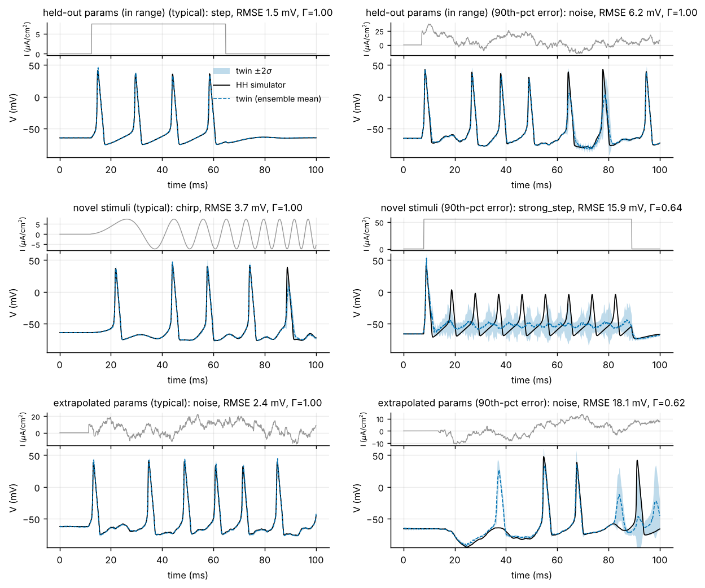

# neuro-digital-twin

A fast, uncertainty-aware deep-learning **digital twin of a Hodgkin-Huxley
neuron**. A PyTorch surrogate learns the map (biophysical parameters,
injected current) → membrane-potential trace. It replaces the stiff ODE
integrator at a fraction of the cost and reports, through a deep ensemble, when
it is extrapolating.

* **Results** (accuracy on held-out parameters, speed-up, uncertainty, failure
  modes): [`docs/RESULTS.md`](docs/RESULTS.md)
* **Background for neuroscientists**, with references:
  [`docs/SCIENCE.md`](docs/SCIENCE.md)



## What is in the box

| component | file | notes |
|---|---|---|
| Reference simulator | `src/neurotwin/hh.py` | Hodgkin-Huxley (1952) neuron with Q10 temperature scaling. Uses scipy LSODA as the reference and vectorised numpy RK4 (with a stiff fallback) to build datasets. |
| Stimuli | `src/neurotwin/stimuli.py` | Steps, ramps, Ornstein-Uhlenbeck noise and pulse trains (training); strong steps and chirps (never seen in training). |
| Datasets | `src/neurotwin/data.py` | (θ, I(t)) → (V, m, h, n)(t) pairs plus summary features. Splits: train, validation, in-range test, extrapolated parameters, novel stimuli. |
| Surrogates | `src/neurotwin/models.py` | Patch-wise **GRU** sequence model and a **neural ODE** in the HH state space. Both are trained and compared; the better one becomes a deep ensemble. |
| Training | `src/neurotwin/train.py` | GRU: backpropagation through the full trace. Neural ODE: multiple shooting with a window curriculum. |
| Evaluation | `src/neurotwin/evaluate.py`, `features.py` | Coincidence factor Γ, spike counts, latency, sub-threshold RMSE, f-I curves, uncertainty AUROC and calibration, and timing against scipy and numpy. |
| Pipeline / CLI | `src/neurotwin/pipeline.py`, `__main__.py` | One command runs the whole experiment and writes `metrics.json`, `report.md`, figures and checkpoints. |

## Quick start

No GPU, no API keys and no external data: everything is simulated locally.

```bash
python -m venv .venv && source .venv/bin/activate
```

```bash
pip install torch --index-url https://download.pytorch.org/whl/cpu
```

```bash
pip install -e ".[dev]"
```

Run the small default experiment (about 8 minutes on a 4-core CPU):

```bash
python -m neurotwin run --config configs/small.yaml
```

Run the full experiment behind `docs/RESULTS.md` (about 1 hour on a 4-core CPU):

```bash
python -m neurotwin run --config configs/full.yaml --out results/full --figdir docs/figures
```

Each run writes the following to `results/<name>/`:

* `metrics.json`: every number in the report, plus the full config and
  environment.
* `report.md`: the results tables.
* `figures/`: the plots (unless `--figdir` points elsewhere).
* `twin/`: the trained ensemble.
* `data/`: the cached simulations.

### Using a trained twin from Python

```python
import numpy as np
from neurotwin.pipeline import load_twin

twin = load_twin("results/small/twin")         # written by `neurotwin run`
theta = np.array([[120.0, 36.0, 0.3, 1.0]])    # g_Na, g_K, g_L (mS/cm^2), C_m (uF/cm^2)
current = np.zeros((1, 1000))                  # 100 ms at dt = 0.1 ms, uA/cm^2
current[0, 100:900] = 10.0                     # 80 ms step of 10 uA/cm^2
mean, sigma, members = twin.predict(theta, current)   # mV, shapes (1, 1000)
print("ensemble spread (mV):", sigma.mean())  # large spread -> re-check with the simulator
```

## Development

The tests run fully offline in about a minute on a 4-core CPU.

```bash
ruff check src tests
```

```bash
mypy
```

```bash
pytest
```

GitHub Actions (`.github/workflows/ci.yml`) has two jobs:

* lint, strict type-checking and tests on Python 3.11 and 3.12;
* an end-to-end run of the small configuration, whose results are uploaded as
  a build artifact.

## License

MIT © 2026 Cesar Daniel Reinoso. See [LICENSE](LICENSE).
