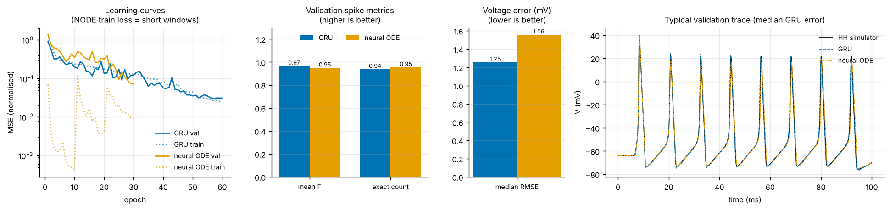
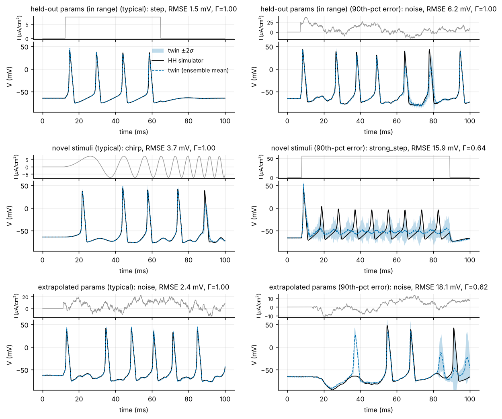
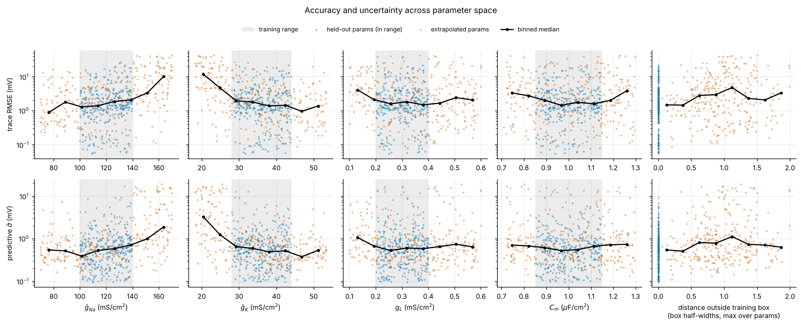
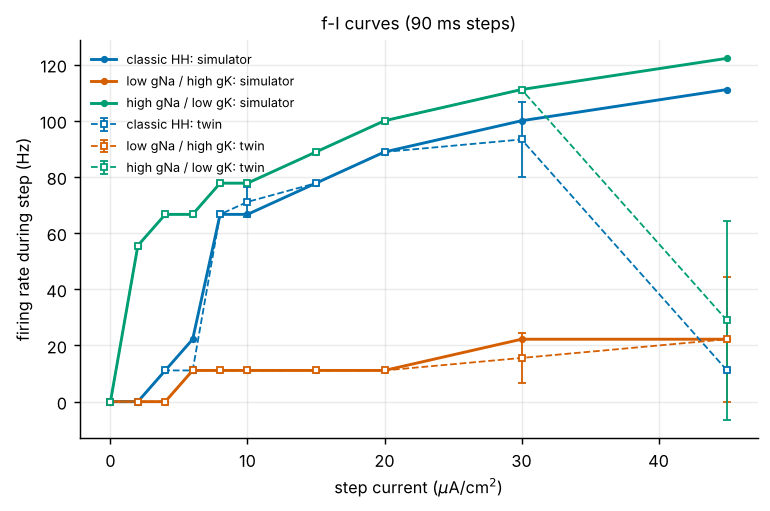
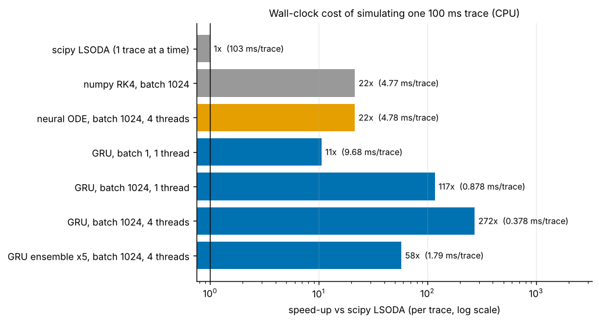
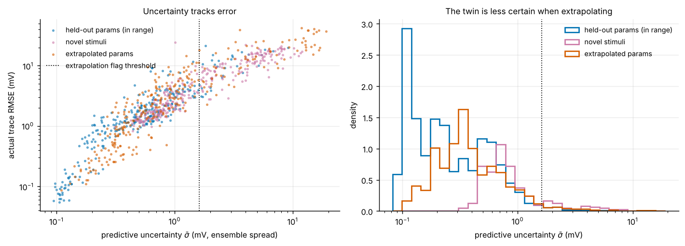
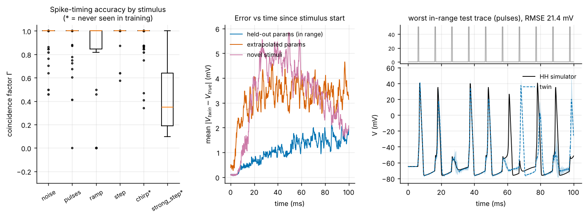
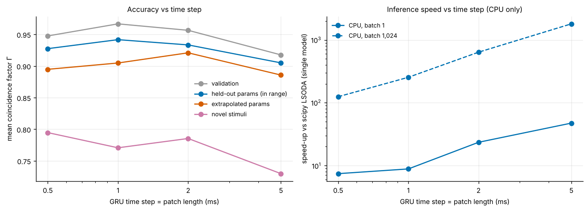

# Results

Every number below comes from the **full** configuration
([`configs/full.yaml`](../configs/full.yaml)). The default twin is an
ensemble of 5 GRUs that advance **1 ms per recurrent step**. An earlier
version of this study used 0.5 ms steps; §9 explains the change and compares
the two.

* **Hardware:** a 4-core x86-64 CPU, no GPU; Python 3.13, PyTorch 2.15, numpy 2.5.
* **Runtime:** about 38 min from scratch on 4 cores:
  * ≈ 22 min for the two candidate architectures, trained side by side;
  * ≈ 11 min for the 4 further ensemble members;
  * ≈ 4 min for evaluation and figures.

  The committed run reused those cached models and took 3.5 min.
* **Sources:** the raw numbers are in
  [`results/full/metrics.json`](../results/full/metrics.json), the
  auto-generated tables in [`results/full/report.md`](../results/full/report.md)
  and the log in [`results/full/run.log`](../results/full/run.log).

For the default `small` configuration that CI runs, see §8. For the biology,
numerics and metric definitions, see [SCIENCE.md](SCIENCE.md).

```bash
python -m neurotwin run --config configs/full.yaml --out results/full --figdir docs/figures
```

## Summary

| question | answer |
|---|---|
| Which surrogate? | **An ensemble of 5 GRUs with 1 ms steps.** The GRU is more accurate than a state-space neural ODE on validation and ties it on the held-out test set. The neural ODE is no faster than integrating the real equations in batch (§2). |
| Accuracy on held-out parameters (in range) | Spike coincidence **Γ = 0.94** (median 1.0); **87 %** of traces have the exact spike count; median voltage RMSE **1.5 mV** (0.34 mV sub-threshold); median first-spike latency error **13 µs**. |
| Accuracy when extrapolating | Parameters outside the training box: Γ = 0.88. Novel stimuli: Γ = 0.74, ranging from 0.97 for chirps to 0.43 for strong steps. |
| Speed-up | One GRU is **272×** faster than scipy LSODA (0.38 vs 103 ms per 100 ms trace, batch 1 024, 4 threads). The 5-member ensemble with uncertainty is **58×** faster. Against a vectorised numpy RK4 integrator of the same equations, the gains are **13×** and **2.7×**. |
| Does it know when it is extrapolating? | Mostly. Ensemble spread ranks trace errors with Spearman ρ = 0.93. The flag fires on 26 % of test traces and catches 96 % of those with RMSE > 10 mV. Spread detects novel stimuli (AUROC 0.81) much better than extrapolated parameters (0.62), so the twin pairs it with an exact parameter-range check. |
| Main failure modes | Sustained drive far beyond the training range (the f-I curve collapses at 45 µA/cm²); near-threshold and near-refractory inputs, occasionally with confident errors; ramps; spike-time drift late in the trace (§6). |

## 1. Data

| split | traces | parameters | stimuli |
|---|---|---|---|
| train | 4 000 | training box | step, ramp, OU noise, pulse train |
| validation | 300 | training box (new draws) | same families |
| test_id | 300 | training box (new draws) | same families |
| test_ood_param | 300 | wider box, outside the training box in ≥ 1 parameter | same families |
| test_ood_stim | 300 | training box (new draws) | strong steps (25–60 µA/cm²), chirps 2→200 Hz |

* **Trace format:** 100 ms at 0.1 ms resolution, i.e. 1 000 samples per trace.
* **Ground truth:** HH equations integrated by RK4 at 0.02 ms, with a stiff
  LSODA fallback that was needed for 1 of the 5 200 traces. Agreement with
  LSODA at rtol = 1e-9 on 50 test traces:
  * max |ΔV| = 0.016 mV;
  * RMSE = 3.4·10⁻⁴ mV;
  * identical spike trains (Γ = 1.000).

  The simulator's numerical error is therefore three orders of magnitude
  below the surrogate errors reported here.
* **Simulation cost:** about 30 s on 4 cores for all 5 200 traces.

## 2. Choosing the architecture: GRU vs neural ODE



Both candidates were trained on the same data:

* the GRU for 60 epochs, which took 629 s on 1 CPU thread;
* the neural ODE for 30 epochs of multiple shooting, which took 1 306 s on 2
  threads.

**Validation set (300 traces):**

| model | weights | mean Γ | exact spike count | median RMSE (mV) | mean RMSE (mV) | median sub-thr. RMSE (mV) | batched speed-up vs scipy |
|---|---|---|---|---|---|---|---|
| **GRU** (2×128, 1 ms steps) | 206 k | **0.967** | 0.937 | **1.25** | **2.15** | 0.34 | **263×** |
| neural ODE (MLP 4×128, RK4 at 0.05 ms) | 36 k | 0.949 | **0.953** | 1.56 | 3.28 | **0.28** | 18× |

**Held-out in-range test set, single model each:**

| model | mean Γ | exact spike count | median RMSE (mV) |
|---|---|---|---|
| GRU | 0.942 | 0.893 | **1.40** |
| neural ODE | 0.943 | **0.937** | 1.78 |

**Accuracy.**

* *GRU advantages:* higher validation Γ, and lower median and mean voltage
  error.
* *Neural ODE advantages:* it keeps a small edge in exact spike counts and
  sub-threshold voltage. On the held-out test set the two tie on Γ.
* *Why the neural ODE does so well with 6× fewer weights:*
  * privileged access to the gating variables (m, h, n) during training;
  * a strong inductive bias, since it only learns a smooth local vector
    field.
* *Its rare errors are larger:* its *mean* RMSE is clearly worse. When a
  rollout drifts, it drifts further.
* *With little data the gap is wide.* On the small configuration (800
  traces) the GRU is clearly better: Γ 0.84 vs 0.70 (§8).

**Speed.** The neural ODE inherits the stiffness of the HH equations:

* RK4 on the true equations diverges at 0.1 ms, so the neural ODE must step
  at 0.05 ms.
* That costs 2 000 MLP evaluations per trace, against 100 GRU steps.
* Batched, it costs 4.8 ms per trace. That is the same as integrating the
  *real* HH equations with the same batched RK4 approach in numpy (4.8 ms).
* For a single trace it is 6× *slower* than scipy (589 vs 103 ms).

A neural ODE in the native state space therefore gives no computational
advantage over the model it emulates. The GRU learns the flow map over 1 ms
steps and is 13× faster batched and 60× faster for a single trace.

**Decision rule.** Among candidates whose validation Γ is within 0.01 of the
best, choose the fastest. The GRU is both the most accurate and the fastest,
so it is the twin. If exact spike counts per weight matter more than speed,
the neural ODE remains a strong emulator. `models.NeuralODESurrogate` is kept
for that purpose.

> **How the choice evolved (for transparency).** The selection rule and the
> GRU's time step were revised during this study. The superseded runs'
> numbers are kept in [`results/full_p5`](../results/full_p5).
>
> 1. *Accuracy alone.* The first full run selected on validation Γ alone,
>    with 0.5 ms GRU steps. With a 40-epoch GRU (less training than the
>    neural ODE), the neural ODE won: Γ 0.954 vs 0.934.
> 2. *A hard speed gate.* The brief requires the twin to be far faster than
>    the integrator, so the rule became "most accurate model with ≥ 100×
>    speed-up", and the GRU got an equal budget of 60 epochs. The two then
>    tied (Γ 0.948 vs 0.949). The GRU measured 98× in one run and 120× in
>    another, so a hard gate on so noisy a measurement is fragile.
> 3. *The tie-aware rule above.* It selects the 0.5 ms GRU whatever its
>    measured speed.
> 4. *A patch-length sweep.* It showed that 1 ms steps are both more
>    accurate and twice as fast (§9). The 1 ms GRU now wins on accuracy as
>    well as speed.

## 3. Accuracy on held-out parameters



*Each row shows a typical trace (median error) and a bad one (90th-percentile
error) from one test set. Grey: injected current. Black: HH simulator. Blue
dashed: twin (ensemble mean). Shaded: ±2σ ensemble spread.*

| split | spiking traces | mean Γ | median Γ | exact spike count | spike-count R² | median RMSE (mV) | median sub-thr. RMSE (mV) | median 1st-spike latency error (ms) |
|---|---|---|---|---|---|---|---|---|
| test_id (in range) | 85 % | **0.938** | 1.000 | **0.873** | 0.902 | **1.47** | 0.34 | 0.013 |
| test_ood_param (extrapolated θ) | 80 % | 0.883 | 1.000 | 0.823 | 0.605 | 2.40 | 0.55 | 0.04 |
| test_ood_stim (novel stimuli) | 100 % | 0.737 | 1.000 | 0.560 | −2.11 | 3.68 | 0.93 | 0.013 |

**Summary features** (mean absolute error), computed from the predicted
traces:

| split | firing rate (Hz) | first-spike latency (ms) | mean sub-thr. V (mV) | peak V (mV) |
|---|---|---|---|---|
| test_id | 2.7 | 0.57 | 0.46 | 4.7 |
| test_ood_param | 6.3 | 1.66 | 1.42 | 7.6 |
| test_ood_stim | 18.4 | 0.09 | 1.77 | 2.2 |

**Spike timing by stimulus family** (mean Γ; * = never seen in training):

| noise | pulses | ramp | step | chirp* | strong step* |
|---|---|---|---|---|---|
| 0.960 | 0.944 | 0.797 | 0.985 | 0.974 | 0.431 |

**In range.**

* The twin reproduces spike times to within the 2 ms coincidence window on
  the large majority of traces. The median trace is perfect (Γ = 1).
* The first spike is placed with a median error of 13 µs.
* The sub-threshold membrane potential is accurate to about 0.3 mV.

**Extrapolated parameters.**

* Accuracy degrades gracefully: Γ drops from 0.94 to 0.88 and median RMSE
  rises from 1.5 to 2.4 mV.
* The decline concentrates where extrapolation makes the cell *more*
  excitable: high $\bar g_{Na}$ and low $\bar g_K$ (figure below). There, the
  binned median RMSE climbs to ~10 mV at the edges of the wider box.
* Changes of $g_L$ and $C_m$ beyond the training range are tolerated better.

**Novel stimuli.**

* The twin generalises to chirps (Γ 0.97), which recombine frequencies and
  amplitudes it has seen.
* It fails on sustained strong steps (Γ 0.43). It fires the first spike
  correctly and then under-fires; see §6.



*Per-trace RMSE (top) and ensemble spread (bottom) against each parameter.
The grey band is the training range; black lines are binned medians. The
right-most column pools all parameters as the distance outside the training
box, in units of the box half-width.*

**Ensemble mean vs a single member.**

| split | mean Γ, ensemble mean | mean Γ, single member | median RMSE, ensemble mean (mV) | median RMSE, single member (mV) |
|---|---|---|---|---|
| test_id | 0.938 | 0.947 | 1.47 | 1.69 |
| test_ood_param | 0.883 | 0.895 | 2.40 | 2.69 |
| test_ood_stim | 0.737 | 0.779 | 3.68 | 4.06 |

Averaging the members lowers the voltage RMSE. It also slightly *lowers*
spike metrics, because where members disagree on timing the averaged trace
smears or shrinks the disputed spike. Downstream spike statistics should
therefore be computed per member and then averaged, which is how the f-I
curves below are made.



**f-I curves** (90 ms steps):

* The twin reproduces the f-I curves of the classic neuron and of two corners
  of the training box up to 20 µA/cm², the maximum of the training steps.
  * That includes the discontinuous class-II onset at ≈6–8 µA/cm².
  * It includes the near-silent "single-spike" corner (low $\bar g_{Na}$,
    high $\bar g_K$).
* At 30 µA/cm² it still follows closely (classic cell 93 vs 100 Hz).
* It errs at 6 µA/cm² for the classic cell (11 vs 22 Hz: one spike instead
  of two). This is just below the onset of repetitive firing (≈6.3 µA/cm²),
  where the response is most sensitive.
* It collapses at 45 µA/cm² (classic: 11 vs 111 Hz). The members disagree
  strongly there (error bars).
* Mean absolute rate error over all points: 7.4 Hz.

## 4. Speed-up



Milliseconds of CPU wall-clock per simulated 100 ms trace (1 000 output
samples), from the committed run:

| method | batch | threads | ms / trace | vs scipy LSODA | vs numpy RK4 |
|---|---|---|---|---|---|
| scipy LSODA, one trace at a time (reference) | 1 | 1 | 103 | 1× | 0.05× |
| numpy RK4, vectorised, 0.02 ms step | 1 024 | 1 | 4.77 | 22× | 1× |
| neural ODE | 1 024 | 4 | 4.78 | 22× | 1.0× |
| neural ODE, single trace | 1 | 1 | 589 | 0.17× | — |
| **GRU, single trace** | 1 | 1 | 9.7 | **11×** | — |
| GRU | 64 | 4 | 0.67 | 153× | 7.1× |
| GRU | 1 024 | 1 | 0.88 | 117× | 5.4× |
| **GRU** | 1 024 | 4 | **0.38** | **272×** | **12.6×** |
| **GRU ensemble ×5 (with uncertainty)** | 1 024 | 4 | 1.79 | **58×** | **2.7×** |

How to read these numbers:

* **Against the usual workflow, a serial adaptive solver, one GRU is 272×
  faster.** That is within the 100–1 000× range typically quoted for neural
  surrogates. In practice: 10 000 traces take ~4 s instead of ~17 min.
* **Much of that gain comes from batching, not from the network.**
  * A carefully vectorised fixed-step integrator of the *true* equations is
    itself 22× faster than LSODA.
  * Against it, one GRU is 13× faster and the 5-member ensemble 2.7×.
  * Speed-up claims for neural surrogates should always state the baseline.
* **Single-trace latency is where the twin helps least:** 6–10 ms vs ~100 ms
  (10–16×).
  * It is still the fastest option for one trace. Fixed-step numpy RK4 has
    large per-step overhead at batch size 1 and takes 1.5 s per trace.
  * Single-trace timings are also the noisiest. The same model measured
    6.3 ms in a head-to-head benchmark (§9) and 9.7 ms in this run.
* **Further routes to more speed:**
  * a GPU (not yet run, see §9);
  * 2 ms steps, a further 2.5× at a small accuracy cost (§9);
  * distilling the ensemble into a single network that predicts mean and
    spread.

Speed measurements vary by 20–40 % between runs on the same machine (scipy
took 87–103 ms per trace across the full-configuration runs). Treat speed-up factors
as accurate to that level.

## 5. Uncertainty



The extrapolation flag fires when the time-averaged ensemble spread
$\bar\sigma$ exceeds 1.62 mV, the 95th percentile on the validation set.

| split | median $\bar\sigma$ (mV) | ±2σ coverage | Spearman($\bar\sigma$, RMSE) | flagged by σ | flagged by σ or range check |
|---|---|---|---|---|---|
| test_id | 0.54 | 0.86 | 0.91 | 9.7 % | 9.7 % |
| test_ood_param | 0.70 | 0.79 | 0.93 | 24.0 % | 100 % |
| test_ood_stim | 1.17 | 0.84 | 0.94 | 43.7 % | 43.7 % |

* **The spread is a good error ranker.** Pooled over all test sets, Spearman
  ρ($\bar\sigma$, RMSE) = 0.93.
* **The flag separates good from bad predictions:**

  | | mean Γ | median RMSE |
  |---|---|---|
  | flagged traces | 0.50 | 12.3 mV |
  | unflagged traces | 0.98 | 1.6 mV |

  Across the three test sets the flag fires on 26 % of traces, yet it catches
  96 % of the traces with RMSE > 10 mV and 81 % of those with RMSE > 5 mV.
  Re-simulating the flagged traces with the simulator therefore removes
  almost all of the large errors at a quarter of the simulation cost.
* **It detects novel stimuli better than novel parameters.**
  * AUROC for separating in-range from novel-stimulus traces is 0.81. For
    extrapolated parameters it is only 0.62.
  * The spread correlates only weakly with the distance outside the
    training box (ρ = 0.12).
  * The reason: most extrapolated-parameter traces are predicted *well*
    (Γ 0.88), so their low uncertainty is correct. The spread tracks
    *error*, not novelty per se.
  * Parameter novelty is caught exactly and for free by a range check:
    every θ is normalised so the training box is [−1, 1]⁴. The twin
    therefore reports both.
* **Intervals are only roughly calibrated.**
  * About 86 % of in-range samples fall within ±2σ, against a nominal 95 %.
  * Coverage is lowest around spikes: 70 % within −1 to +4 ms of a spike,
    against 86 % elsewhere. Near a spike, a 0.2 ms timing error is a 50 mV
    voltage error.
  * Use σ to rank and flag, not as a likelihood.
* **The flag rate on in-range test data is 9.7 %.** The 95th-percentile
  threshold was set on 300 validation traces, so the nominal 5 % is only
  approximate.

## 6. Failure modes



1. **Sustained drive beyond the training range.**
   * Steps of 25–60 µA/cm² give Γ = 0.43 and spike-count R² < 0.
   * The twin fires the first spike correctly, then produces damped,
     sub-threshold oscillations instead of a high-rate spike train (§3,
     traces; f-I at 45 µA/cm²).
   * The network has not learned the high-rate limit cycle it never saw.
   * The ensemble spread does rise sharply (flag rate 44 %), so the failure
     is visible.
2. **Near-threshold and near-refractory inputs, occasionally with confident
   errors.**
   * The worst in-range trace (right panel, RMSE 21 mV) is a 51 µA/cm² pulse
     train at ~100 Hz, close to the refractory limit.
   * The simulator skips 3 of the 10 pulses and answers one with a 4 ms
     delay. The twin skips a different subset.
   * That trace *is* flagged (σ 1.8 mV). Confident errors remain, but they
     are rare: 6 of the 900 test traces have RMSE > 10 mV with σ below the
     flag.
   * Example: an in-range ramp to 29 µA/cm² where the simulator fires 4
     spikes and the twin none (σ 1.4 mV). Members share the training data
     and its blind spots, so a deep ensemble cannot rule such errors out.
   * Threshold inputs are intrinsically ill-conditioned: an infinitesimal
     input change flips spike/no-spike. Hodgkin-Huxley's bistability between
     ≈6.3 and ≈9.8 µA/cm² (SCIENCE §6) makes the step and ramp regime around
     it the hardest.
3. **Ramps.**
   * They are the weakest training family (mean Γ 0.80).
   * In the ramp's threshold region the stimulus rises slowly, so the moment
     of the first spike is very sensitive to small errors (accommodation).
   * Every later spike inherits the shift.
4. **Spike-time drift.**
   * The in-range error grows from ≈0.5 mV just after stimulus onset to
     ≈2 mV at 100 ms (middle panel).
   * Once one spike is late, everything after it is shifted.
   * Longer simulations would need periodic re-anchoring to the simulator,
     or training on longer windows.
5. **Excitable extrapolations.**
   * High $\bar g_{Na}$ (> 150) or low $\bar g_K$ (< 25) make the cell much
     more excitable, though not spontaneously active.
   * A 3 µA/cm² step evokes 5–6 spikes instead of the single spike of the
     classic cell.
   * Error and spread rise together (§3 figure).
6. **Blurred ensemble mean.**
   * Where members disagree, their average lowers and widens the disputed
     spikes (§3).
   * This is not a failure of the uncertainty, but it means "the ensemble
     mean trace" should not be fed to a spike detector without care.

## 7. Reproducibility

* All randomness is seeded. Re-running a configuration reproduces the
  training trajectories epoch by epoch (identical losses in `run.log`) and
  identical accuracy numbers. Only the speed timings change between runs.
* The simulated datasets and the trained models are cached in
  `results/<config>/data` and `results/<config>/models`. Neither is
  committed; both regenerate from the config.
* The trained 5-member twin is committed in `results/full/twin` (4 MB).
  `tests/test_shipped_twin.py` checks it against the simulator on every CI
  run.
* The superseded 0.5 ms twin's metrics, report and log are in
  [`results/full_p5`](../results/full_p5). Its weights are in the git
  history, at the merge commit of the first pull request.
* The figures in `docs/figures/` are written by the same command.

## 8. Small (default, CI) configuration

The default configuration ([`configs/small.yaml`](../configs/small.yaml)) is
what CI runs end-to-end on every pull request. It also uses 1 ms steps.

| | small | full |
|---|---|---|
| training traces / test traces per split | 800 / 100 | 4 000 / 300 |
| GRU (hidden, epochs) / ensemble members | 64, 20 / 3 | 128, 60 / 5 |
| validation Γ: GRU / neural ODE | 0.837 / 0.702 | 0.967 / 0.949 |
| validation median RMSE: GRU / neural ODE (mV) | 4.51 / 11.05 | 1.25 / 1.56 |
| selected | GRU | GRU |
| test_id: Γ / exact count / median RMSE (mV) | 0.901 / 0.75 / 4.20 | 0.938 / 0.87 / 1.47 |
| test_ood_param: Γ / median RMSE (mV) | 0.763 / 5.48 | 0.883 / 2.40 |
| test_ood_stim: Γ / median RMSE (mV) | 0.554 / 10.76 | 0.737 / 3.68 |
| AUROC σ: ID vs extrapolated params / novel stimuli | 0.64 / 0.87 | 0.62 / 0.81 |
| one GRU, largest batch, 4 threads: ms / trace | 0.22 (batch 256) | 0.38 (batch 1 024) |
| ensemble, largest batch, 4 threads: ms / trace | 0.62 (3 members) | 1.79 (5 members) |
| pipeline wall-clock (4-core CPU) | ~5 min | ~38 min (from scratch) |

The trends with more data and capacity:

* Accuracy improves across the board: in-range Γ rises from 0.90 to 0.94
  and median RMSE falls from 4.2 to 1.5 mV.
* The neural ODE improves most. It is clearly worse than the GRU with 800
  traces and comes close with 4 000.

**Effect of the 1 ms step at small scale.** With 0.5 ms steps the small
configuration gave:

* validation Γ 0.856;
* test Γ 0.890;
* median RMSE 3.9 mV.

So at 800 traces and 20 epochs the change is accuracy-neutral within the
noise of 100 test traces. It makes one GRU 2.4× faster (0.22 vs 0.52 ms per
trace).

The numbers for this configuration are in
[`results/small/metrics.json`](../results/small/metrics.json) and
[`results/small/report.md`](../results/small/report.md). CI uploads the same
files, plus figures, as the `small-results` artifact of every run.

## 9. Choosing the GRU time step, and GPU readiness

**No GPU run yet.** This study's machine is CPU-only: no CUDA device, no GPU
cloud environment, no cloud credentials. Everything in this section was
therefore measured on the same 4-core CPU.

The code is GPU-ready (`device: auto` uses CUDA when PyTorch sees it), so the
GPU experiment is one command on any CUDA machine:

```bash
python -m neurotwin run --config configs/full.yaml --device cuda --out results/full_gpu
```

```bash
python -m neurotwin sweep --config configs/full.yaml --device cuda --out results/full_gpu --patches 5 10 20 50
```

On a GPU these commands add GPU timings to the speed table and the sweep, at
batch sizes 1, 1 024 and 8 192, next to the CPU timings. The GPU-only tests
in `tests/test_device_sweep.py` are skipped on CPU machines and have not yet
run.

### 9.1 Patch-length sweep

Each GRU step reads and writes a *patch* of samples. The first version of
this study used 5 samples (0.5 ms) per step. Longer patches mean fewer
sequential steps per trace.

The sweep trains one GRU per patch length on identical terms:

* the same 4 000 training traces;
* the same seed and 60 epochs;
* the same architecture (2 × 128 hidden units).

Accuracy is measured on every held-out split
([`results/full/patch_sweep.json`](../results/full/patch_sweep.json)). The
command:

```bash
python -m neurotwin sweep --config configs/full.yaml --out results/full --patches 5 10 20 50
```



| GRU step | steps / trace | val Γ | test Γ | test exact count | test median RMSE (mV) | extrap. params Γ | novel stimuli Γ | CPU batch 1 (ms / trace) | CPU batch 1 024 (ms / trace) | speed-up vs scipy, batch 1 024 |
|---|---|---|---|---|---|---|---|---|---|---|
| 0.5 ms | 200 | 0.948 | 0.927 | 0.89 | 1.80 | 0.895 | 0.795 | 11.8 | 0.70 | 125× |
| **1 ms (default)** | 100 | **0.967** | **0.942** | **0.89** | **1.40** | 0.905 | 0.771 | 9.9 | 0.34 | 254× |
| 2 ms | 50 | 0.957 | 0.933 | 0.87 | 1.90 | **0.921** | 0.785 | 3.7 | 0.14 | 639× |
| 5 ms | 20 | 0.918 | 0.905 | 0.78 | 3.49 | 0.886 | 0.730 | 1.8 | 0.05 | 1 808× |

*Single models, 4 CPU threads. Speed-ups are against scipy LSODA measured in
the same run (87 ms per trace).*

**Speed.**

* Batched inference time is nearly proportional to the number of recurrent
  steps.
* Training time also halves with each doubling: 629 s, 320 s and 140 s for
  the 1, 2 and 5 ms models, each on 1 thread. The 0.5 ms model took 1 244 s
  on 2 threads.

**Accuracy.** Longer steps do *not* cost accuracy up to 2 ms; 1 ms is the
most accurate step on every in-range metric. A plausible reason is
optimisation:

* With 1 ms steps, back-propagation runs through 100 recurrent steps
  instead of 200, so gradients travel half as far.
* A 1–2 ms patch spans roughly one action potential, so the read-out can
  emit the whole spike waveform from a single hidden state.

At 5 ms the accuracy drops: Γ 0.918, and the RMSE doubles. One step then has
to place up to one spike anywhere inside a 5 ms window.

**Selection.** The tie-aware rule of §2 picks **1 ms**. That rule: the fastest
model whose validation Γ is within 0.01 of the best, decided before the sweep
was run. The 2 ms model misses the tie window by 0.0002 (Γ 0.9565 vs 0.9667).
It is a defensible faster choice whenever another factor of 2.5 in speed
matters more than ~0.01 in Γ (`--set gru.patch=20`).

### 9.2 The 1 ms twin against the earlier 0.5 ms twin

Both are full 5-member ensembles trained on the same data with the same
seeds. In the accuracy rows below, 0.5 ms numbers come from
[`results/full_p5`](../results/full_p5) and 1 ms numbers from §1–8.

| ensemble of 5 GRUs | 0.5 ms steps | 1 ms steps (default) |
|---|---|---|
| test_id: mean Γ / exact spike count | 0.934 / 0.877 | 0.938 / 0.873 |
| test_id: median RMSE / sub-threshold RMSE (mV) | 1.70 / 0.48 | **1.47 / 0.34** |
| ramps (weakest training family), mean Γ | 0.761 | **0.797** |
| extrapolated params: mean Γ / median RMSE (mV) | **0.900** / 2.60 | 0.883 / **2.40** |
| novel stimuli: mean Γ (strong steps) | **0.755 (0.474)** | 0.737 (0.431) |
| ±2σ coverage, test_id | 0.73 | **0.86** |
| Spearman(σ, RMSE), pooled test splits | 0.90 | **0.93** |
| share of RMSE > 10 mV traces that are flagged | 90 % | **96 %** |
| AUROC σ: extrapolated params / novel stimuli | 0.64 / 0.82 | 0.62 / 0.81 |
| training time per ensemble member (1 thread) | ~1 300 s | **~680 s** |

Speed is compared head to head, because timings drift between runs. Both
ensembles were loaded in one process and timed interleaved on identical
inputs, keeping the best of 3 rounds × 5 repeats on 4 threads:

```bash
python scripts/benchmark_twins.py results/full/twin <0.5 ms twin> --labels "1 ms" "0.5 ms"
```

| ms per 100 ms trace | 0.5 ms twin | 1 ms twin | speed-up |
|---|---|---|---|
| one GRU, single trace | 11.3 | 6.3 | 1.8× |
| one GRU, batch 1 024 | 0.67 | 0.31 | 2.2× |
| 5-member ensemble, single trace | 63.6 | 28.7 | 2.2× |
| 5-member ensemble, batch 1 024 | 3.78 | 1.97 | 1.9× |

**Verdict: the 1 ms twin became the default.**

* *In range* it is at least as accurate and about twice as fast. Its median
  voltage error is 14 % lower and its sub-threshold error 29 % lower.
* Its uncertainty is better calibrated, and its flag catches more of the
  large errors.
* It *extrapolates* slightly worse: Γ −0.017 on extrapolated parameters and
  −0.018 on novel stimuli. Both are near the ±0.01 sampling noise of a
  300-trace mean. Those traces are flagged about as often (extrapolated
  parameters, 24 %) or more often (novel stimuli, 44 % vs 36 %).

Even at 2.7× the vectorised numpy integrator, the ensemble is a modest gain
*on a CPU*. Large batches on a GPU are where a recurrent surrogate should
pull away further. That is the experiment the commands above are for.
